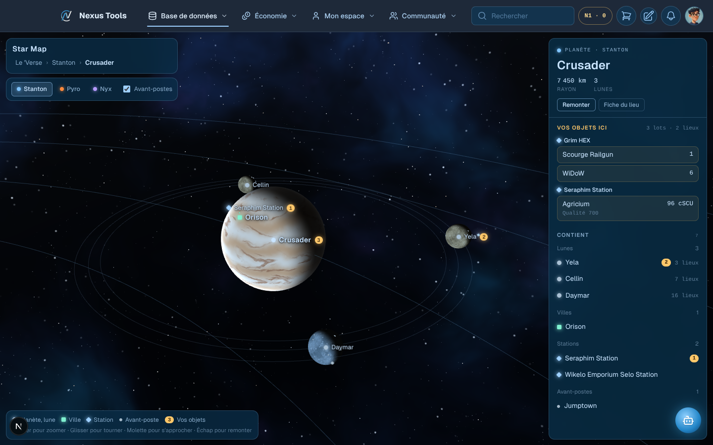
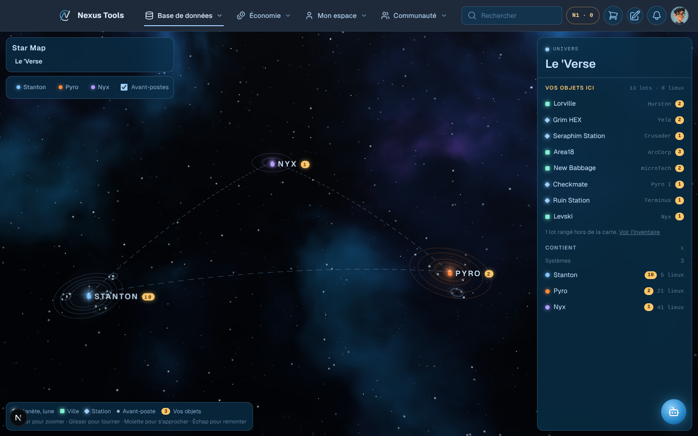
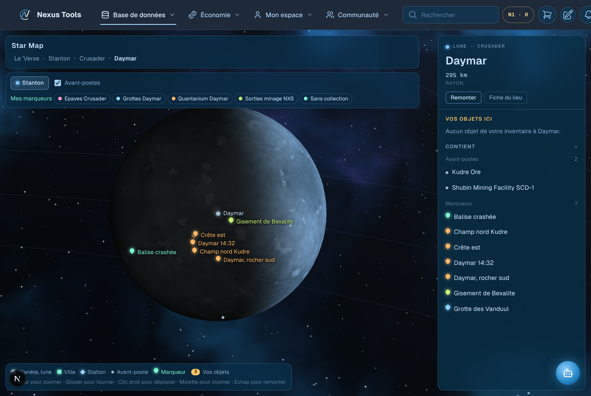
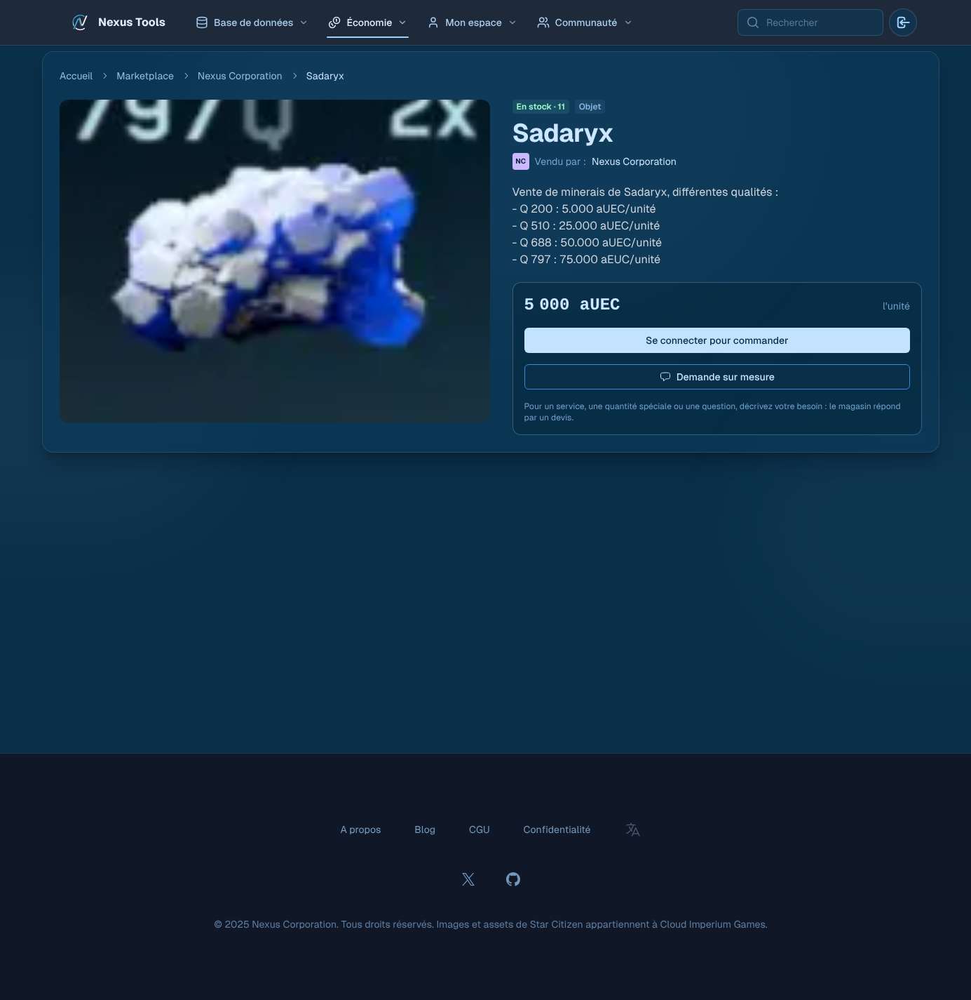
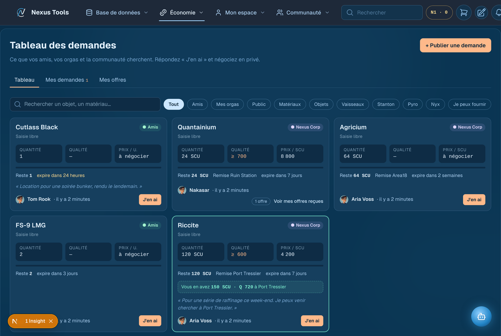
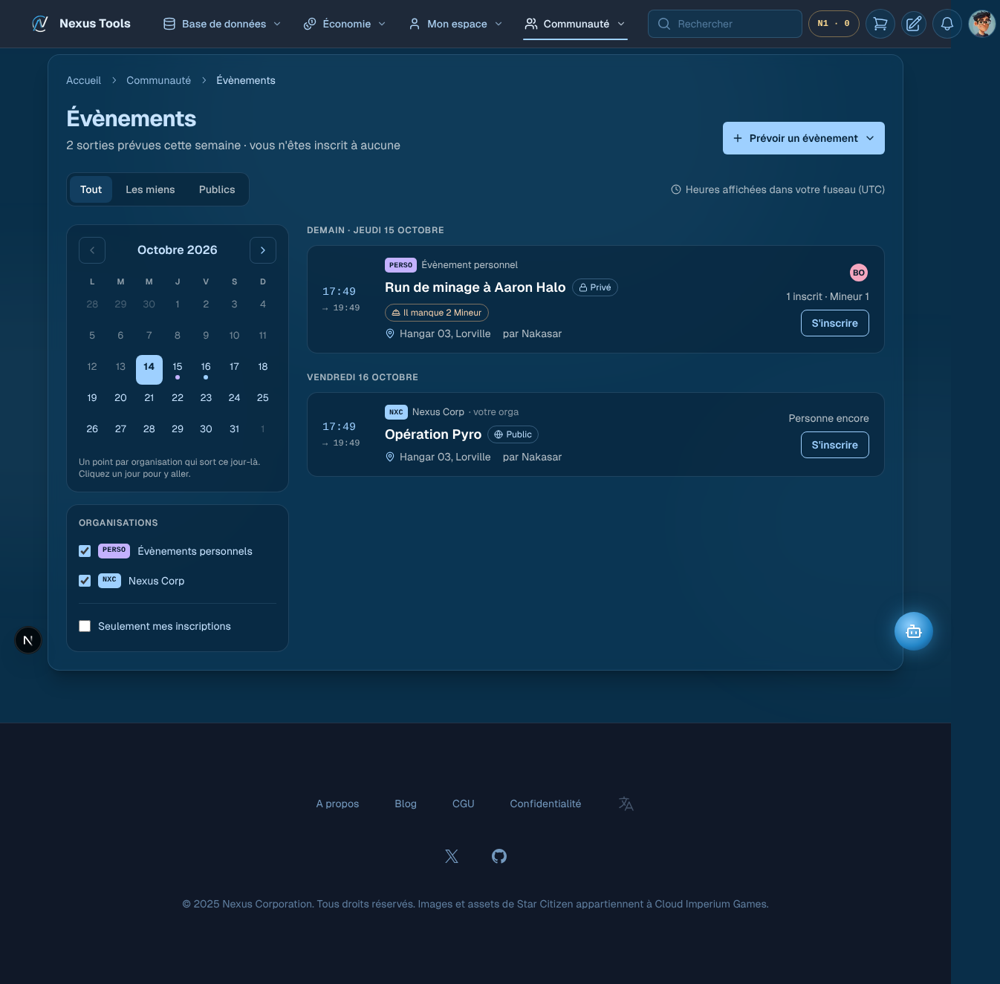
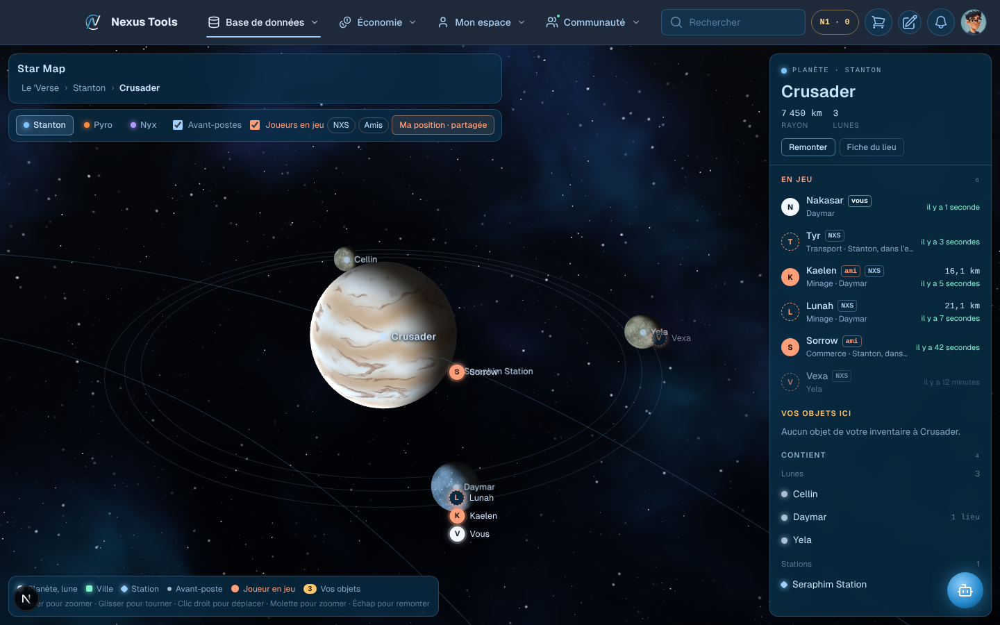

# Nexus Tools

**La boîte à outils communautaire de Star Citizen.**
Votre inventaire, la Star Map, la marketplace entre joueurs, vos évènements
d'orga et un assistant qui connaît le 'Verse, au même endroit.

[**Ouvrir Nexus Tools**](https://tools.services.nexus) ·
[Télécharger Nexus App](https://github.com/NexusCorpSC/nexus-app/releases/latest) ·
[Discord](https://tools.services.nexus/discord)

Nexus Tools est un site gratuit, fait par des joueurs pour des joueurs. La
base de données (objets, blueprints, missions, lieux, lore) se consulte sans
compte ; connectez-vous avec un e-mail, Discord ou une passkey pour tenir votre
inventaire, vendre, organiser des sorties et retrouver vos amis sur la carte.

Le site est disponible en français, en anglais et en espagnol.

## Ce que vous pouvez faire

### Savoir où sont vos affaires

- **Inventaire personnel** : ajoutez un objet en quelques touches, rangez-le
  par lieu et par lot, avec quantité, qualité et notes. La recherche de lieu
  connaît toutes les stations, villes et avant-postes du jeu.
- **Inventaire d'organisation** : partagez un stock avec votre orga et voyez
  qui possède quel blueprint.
- **Colis entre joueurs** : préparez un colis, donnez le code au destinataire ;
  les objets passent dans son inventaire quand il l'accepte.
- **Raffinage** : suivez vos ordres de raffinage, soyez prévenu à la fin, et
  versez le résultat dans l'inventaire d'un clic.
- **Scanner de signature radar** : saisissez la signature qu'affiche le scan
  et voyez quel minerai, astéroïde ou épave elle désigne, et combien de
  rochers la composent.

### Explorer le 'Verse

- **Star Map 3D** de Stanton, Pyro et Nyx : zoomez d'un système à une planète
  puis à une station, et voyez ce que vous y avez stocké.
- **Lieux** : la fiche de chaque station, ville ou avant-poste, avec photos et
  coordonnées ajoutées par la communauté. Créez aussi vos **lieux privés**
  (votre base, une cache), pour vous ou votre orga.
- **Marqueurs de position** : collez la sortie de `/showlocation` pour marquer
  un point, rangez vos marqueurs en collections et partagez-les.
- **Lore** : la Galactapedia et la starmap de RSI, consultables et
  recherchables.

### Trouver une info de jeu

- **Objets, armes, armures, vaisseaux, ressources**, avec caractéristiques et
  points de vente.
- **Blueprints** : la recette, où l'obtenir, et la liste de ceux que vous
  possédez.
- **Missions, factions et réputations** : ce que demande une mission, ce
  qu'elle rapporte, et où vous en êtes avec chaque faction.
- **Évènements officiels** de CIG : la frise des évènements passés, en cours
  et à venir, leurs récompenses, un guide communautaire et les bugs connus.

### Acheter, vendre, demander

- **Marketplace** : tout joueur connecté peut ouvrir son magasin. Achat direct
  avec quantité et lieu de remise, panier sur plusieurs magasins, suivi de
  commande avec messagerie. Vendez directement depuis votre inventaire.
- **Tableau des demandes** : « j'ai besoin de 20 SCU de Quantainium » ; les
  autres joueurs font une offre, vous négociez en privé.

### Jouer ensemble

- **Organisations** : membres, inventaire commun, blueprints de l'orga,
  présence en jeu.
- **Évènements** d'orga ou personnels : calendrier, inscriptions, escouades,
  partage par lien ou avec un joueur précis.
- **Escouades en temps réel** : qui est prêt, qui est à terre, annonces du
  chef, ready check, raids de plusieurs escouades. Pensé pour le téléphone.
- **Amis et position** : partagez votre position depuis Nexus App, vos amis
  vous voient sur la Star Map et peuvent vous rejoindre.

### Demander à Nexus Chat

Un assistant (Claude) qui cherche pour vous dans Nexus Tools et agit sur votre
compte : « je cherche 20 SCU de Laranite », « range ce Quantainium à Lorville »,
« commande chez Sadaryx ». Toute action est d'abord affichée pour que vous la
confirmiez. Il s'ouvre dans un panneau sur chaque page, et se pilote à la voix
dans Nexus App.

L'accès est ouvert par un administrateur.

 

### Enrichir la base

Une coordonnée manquante, une photo de lieu, un conseil de mission : tout le
monde peut **contribuer**. Les propositions sont relues par la communauté, et
chaque contribution acceptée fait monter votre niveau et le classement.

## Nexus App, l'application de bureau

[Nexus App](https://github.com/NexusCorpSC/nexus-app) apporte Nexus Tools
par-dessus le jeu, sous Windows : recherche par raccourci, superpositions
(escouade, NPS, scanner radar, bloc-notes, cargo, Nexus Chat), capture d'écran qui remplit
l'inventaire, positionnement NPS et notifications. Elle utilise le même compte
que le site.

[Télécharger la dernière version](https://github.com/NexusCorpSC/nexus-app/releases/latest)

## Pour les développeurs et les assistants IA

- **Serveur MCP** : branchez Claude ou un autre assistant sur
  `https://tools.services.nexus/mcp` pour qu'il consulte la base et gère votre
  compte. Mode d'emploi sur [/developers](https://tools.services.nexus/developers).
- **Contribuer au code** : la documentation technique (installation locale,
  variables d'environnement, scripts d'import, architecture) est dans
  [docs/](docs/README.md).

## Communauté

Une question, un bug, une idée ? Rejoignez-nous sur
[Discord](https://tools.services.nexus/discord) ou ouvrez une issue sur ce
dépôt.

Fait par la communauté Nexus Corporation. Ni approuvé, ni affilié à Cloud
Imperium. Les images et assets de Star Citizen appartiennent à Cloud Imperium
Games.
